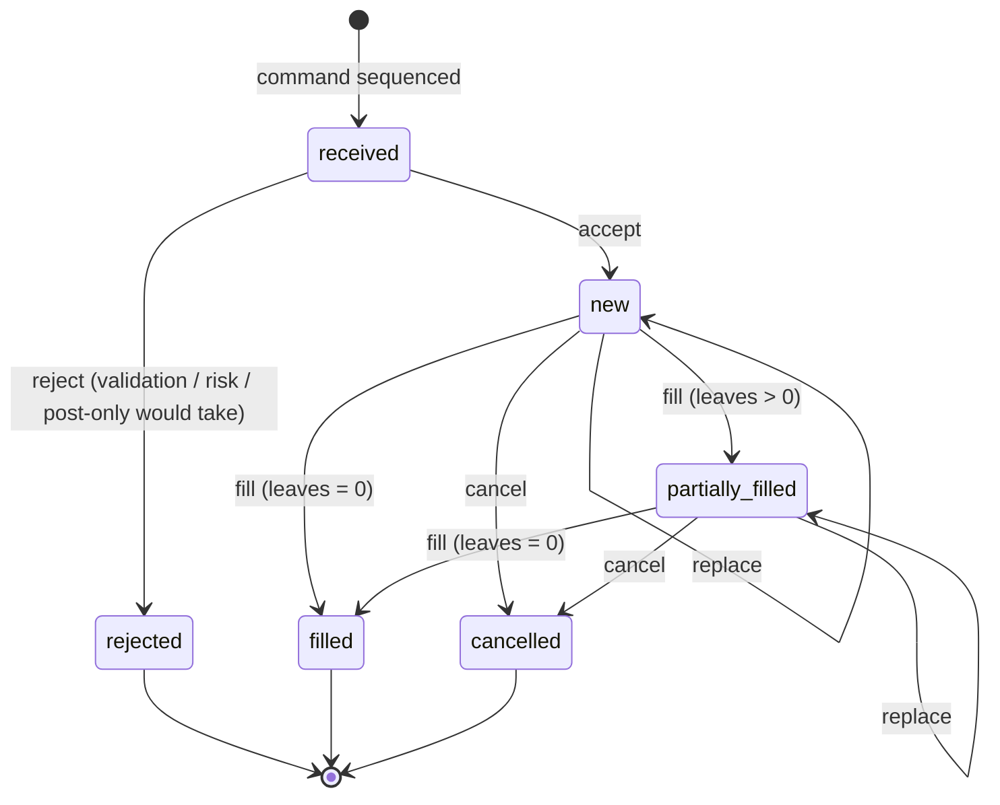

# Nova Venue — Order State Machine

Status: Milestone 8. Implemented in `src/venue/state-machine.ts`, which every status change in the
engine goes through. An illegal transition is an integrity error, and the engine stops
(MATCHING-RULES D-3).

## Transition table (normative)

`src/venue/docs.test.ts` checks that this table is identical to `ORDER_TRANSITIONS`.

| From | Cause | To |
|---|---|---|
| received | reject | rejected |
| received | accept | new |
| new | fill | partially-filled |
| new | fill | filled |
| new | cancel | cancelled |
| new | replace | new |
| partially-filled | fill | partially-filled |
| partially-filled | fill | filled |
| partially-filled | cancel | cancelled |
| partially-filled | replace | partially-filled |

## States

| State | Stored | In book | Meaning |
|---|---|---|---|
| `received` | no | no | Sequenced command, before validation. Transient: it exists only inside one command. |
| `rejected` | no order record | no | Refused before acceptance. Uses no order ID or client ID. A `rejected` event goes to the owner. |
| `new` | yes | yes (between commands) | Accepted, nothing filled. |
| `partially-filled` | yes | yes (between commands) | Some quantity filled, leaves > 0. |
| `filled` | yes | no | Terminal. Filled quantity = order quantity. |
| `cancelled` | yes | no | Terminal. Carries a reason (below) and the filled quantity at cancel time. |

Live means `new` or `partially-filled`. Between commands, an order is live if and only if it rests
in exactly one queue of exactly one price level. Reconciliation checks this.

## Causes and the events they emit (to the owner)

| Cause | Event | Triggered by |
|---|---|---|
| accept | `accepted` (full order view) | new-order command that passes validation (MATCHING-RULES §11) |
| reject | `rejected` (client ID and reason) | validation, risk, halted, suspended, duplicate client ID, post-only would take |
| fill | `fill` (one per execution, per side) | matching on arrival (M-1) or a crossing replace (P-4) |
| replace | `replaced` (new view, `priorityRetained`) | replace command (P-2, P-3) |
| cancel | `cancelled` (reason, filled quantity) | see reasons below |

Refused cancels and replaces do not change state. They emit `request-rejected`, with reason
`unknown-order`, `order-not-modifiable`, `trading-halted`, a price or quantity reason,
`replace-quantity-below-filled`, `replace-no-change`, `hidden-below-minimum`, a risk reason or
`post-only-would-take`.

### Cancel reasons

| Reason | When |
|---|---|
| `user` | Owner's cancel command |
| `mass-cancel` | Owner's mass cancel |
| `ioc-remainder` | IOC or market order remainder after matching (M-7, M-9) |
| `fok-unfilled` | A FOK that could not fill completely. Nothing was executed (M-8). |
| `self-trade-prevention` | STP cancelled the taker, the maker, or both (S-1) |
| `account-suspended` | Operator suspended the account (R-3) |

## Event order within one command

For a new order, the events are emitted in this order:

1. `accepted`
2. for each execution, in priority order: the maker's `fill`, then the taker's `fill`, interleaved
   with any STP `cancelled` events for makers
3. finally, if the taker does not rest, its `cancelled`

A taker that rests emits no further event. Every event carries the owner's gap-free `accountSeq`.

## Properties (tested)

- Every recorded transition is in the table above.
- Each order's transitions form a path from `received`.
- Nothing ever leaves a terminal state.

These are checked by `properties.test.ts`, over 150 random sequences of 10–120 commands per run.
